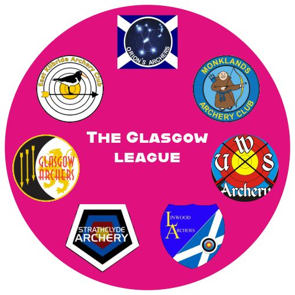

```{r, install}
#install.packages("rmarkdown", "quarto", "tidyverse", "here", "english", "DBI", "duckdb")
```

```{r, setup, include=FALSE}
library(knitr)
library(rmarkdown)
knitr::opts_chunk$set(echo = FALSE)
knitr::opts_chunk$set(fig.width = 8, fig.height = 5)
library(tidyverse)
library(here)
library(english)
source(here("functions", "utility_functions.R"))
```

{width="641"}

This is the place to keep track of what is happening in the Glasgow Archery League, organised by Iain McMillan and the clubs in the league.

See the Events tab for the scores for events that took place at each stage.

## 2026/7 Schedule

| Stage | Date | Time | Location | What3words |
|----|----|----|----|----|
| 1 | 18th October | 9AM - 1PM | Eastwood High School | fluid.trip.tanks |
| 2 | 22nd November | 12:30PM - 4:30PM | Time Capsule | hoping.gloves.shins |
| 3 | 13th December | 9AM - 1PM | Eastwood High School | fluid.trip.tanks |
| 4 | 24th January | 12:30PM - 4:30PM | Time Capsule | hoping.gloves.shins |
| 5 | 21st February | 12:30PM - 4:30PM | Time Capsule | hoping.gloves.shins |
| 6 | 21st March | 12:30PM - 4:30PM | Time Capsule | hoping.gloves.shins |
## Current League Table

```{r}
all_scores <- load_all_archer_scores()
current_clubs <- sort(unique(all_scores$club))
current_season_scores <- all_scores |>
  filter(score > 0, between(event_date, as.Date("2026-10-01"), as.Date("2027-03-31")))
current_table <- current_league_table(current_season_scores, current_clubs)
knitr::kable(current_table)
```
------------------------------------------------------------------------

## Scoring System

+------------------------------------+----------------+
| Club Position in event             | Ranking points |
|                                    |                |
| (top four archers combined scores) |                |
+====================================+================+
| 1st                                | 5              |
+------------------------------------+----------------+
| 2nd                                | 4              |
+------------------------------------+----------------+
| 3rd                                | 3              |
+------------------------------------+----------------+
| 4th                                | 2              |
+------------------------------------+----------------+
| 5th                                | 1              |
+------------------------------------+----------------+
| All others                         | 0              |
+------------------------------------+----------------+

If the rank totals are tied, then the total scores of the top four archers at each event are used to break the tie. In the unlikely event that these scores too are tied, then the matter cannot be settled by bows, and it is pistols at dawn.

If, at the end of a season, two clubs have the same number of match points, total arrow scores of the top four archers at each event (the same scores used for position) is used.
